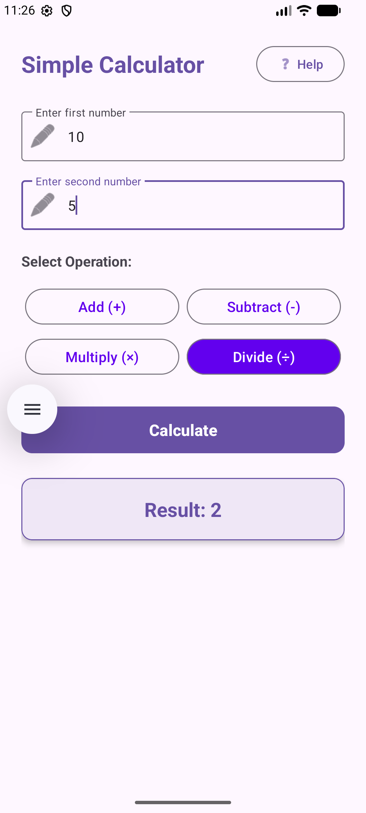
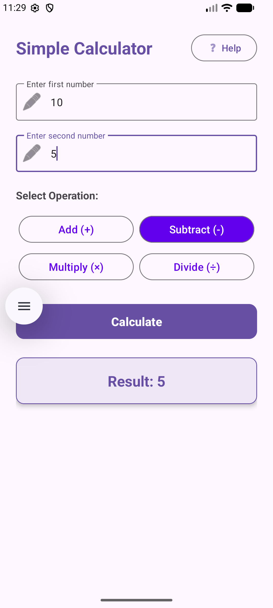
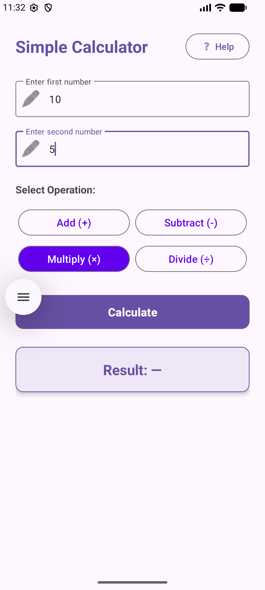
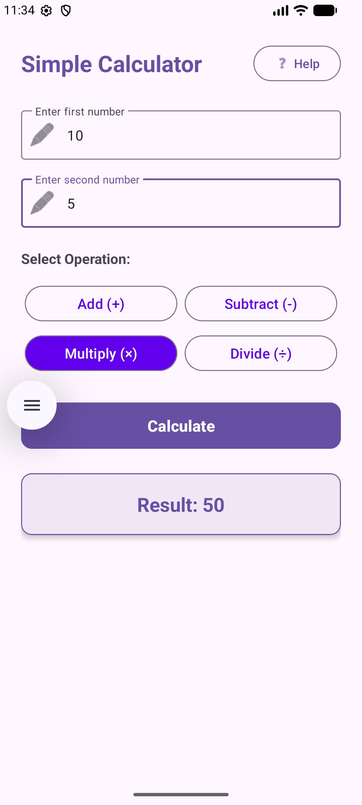

# Simple Calculator - Android App

A clean, modern Android Calculator application built with Kotlin, ViewBinding, and Material Design 3.

---

## 📱 Calculated Solutions & Screenshots

| Addition (+) | Subtraction (-) |
| :---: | :---: |
|  |  |

| Multiplication (×) | Division (÷) |
| :---: | :---: |
|  |  |

---

## ✨ Key Features

- **Plain Text Number Inputs with Hints**: Two guided input fields (`Enter first number` and `Enter second number`) supporting decimal and signed numbers.
- **Operation Selection**: Independent operation buttons for **Addition (+)**, **Subtraction (-)**, **Multiplication (×)**, and **Division (÷)** with visual highlight when selected.
- **Dedicated Calculate Action**: Computes and displays the result **only** after clicking the **Calculate** button.
- **Result Display Box**: Prominent, cleanly formatted result card (`Result: 15`).
- **Help Dialog**: Built-in dialog explaining step-by-step usage instructions.
- **Input Validation & Safety**: Handles missing values with inline error messages and prevents divide-by-zero crashes.

---

## 🛠️ Architecture & Tech Stack

- **Language**: Kotlin
- **UI Framework**: Android Views (XML Layouts)
- **Binding**: ViewBinding (`ActivityMainBinding`)
- **Theme**: Material Components (`Material3`)
- **Min SDK**: API 24 (Android 7.0)
- **Target SDK**: API 37 (Android 15)

---

## 🚀 How to Build & Run

1. Clone this repository:
   ```bash
   git clone https://github.com/abdullahidahir334-cyber/Calculator.git
   ```
2. Open the project in **Android Studio**.
3. Let Gradle sync dependencies.
4. Run on an Android Emulator or connected device (**`Shift + F10`**).
