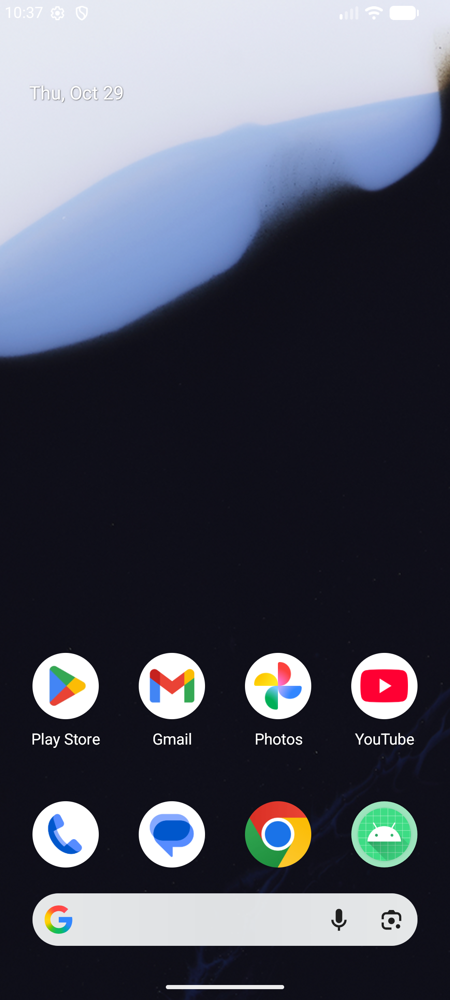

# Simple Calculator - Android App

A clean, modern Android Calculator application built with Kotlin and Material 3 Design components.



## 📱 Features

- **Plain Text Number Inputs**: Two `EditText` / `TextInputLayout` fields with helpful hints ("Enter first number" and "Enter second number").
- **Operations**: Buttons for **Addition (+)**, **Subtraction (-)**, **Multiplication (×)**, and **Division (÷)** with visual highlight upon selection.
- **Calculate Button**: Computes the result only when tapped.
- **Result Display**: Prominently formatted result card.
- **Help Dialog**: Built-in instructions dialog accessible via the **Help** button.
- **Input Validation & Safety**: Gracefully handles invalid numeric entries and prevents divide-by-zero errors.

## 🛠️ Tech Stack & Requirements

- **Language**: Kotlin
- **UI Framework**: Android XML Views with ViewBinding
- **Design**: Material Components (`Material3`)
- **Min SDK**: API 24 (Android 7.0)
- **Target SDK**: API 37 (Android 15)

## 🚀 How to Build & Run

1. Clone or download this repository:
   ```bash
   git clone <YOUR_GITHUB_REPOSITORY_URL>
   ```
2. Open the project in **Android Studio**.
3. Allow Gradle to sync dependencies.
4. Select an Android Emulator or connected device.
5. Click **Run (`Shift + F10`)** to launch the app.

---
Developed as a clean Android Kotlin sample project.
